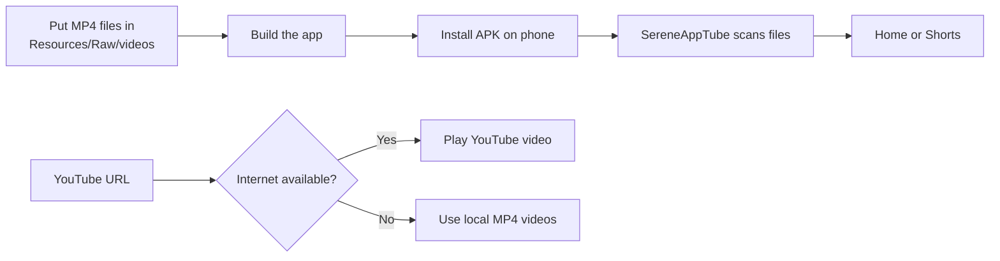

# MyTube – a YouTube-style app for your own video list (.NET MAUI, C#)

A YouTube-like mobile app for **Android** (and iOS) with **no sign-in**. It plays:

- **your list of YouTube videos** (through YouTube's official embedded player)
- **YouTube Shorts**, in a full-screen swipe feed
- **your own videos**: bundled with the app, uploaded from the phone, or linked from the web

Everything is **shuffled randomly** each time you open Home or Shorts.

## Quick start



The simplest workflow is: copy MP4 files, build, install, and play.

## Video rules

| Input | Result |
|---|---|
| `.mp4` in `MyTube/Resources/Raw/videos` | Loaded automatically |
| MP4 shorter than 11 seconds | Classified as a Short |
| `.MOV`, `.MKV`, `.WEBM` in the bundled folder | Ignored until converted to MP4 |
| YouTube URL | Requires internet access |
| Local video playback | Defaults to `0.8×` speed |
| Portrait video | Uses a smaller centered player |
| Landscape video | Uses the normal wide player |

## Features

| Screen | What it does |
|---|---|
| **Home** | Endless shuffled feed of your YouTube links and your own videos. Category chips (Music, Your videos, Recently added, Watched, New to you…), a Shorts shelf, pull to refresh, red "watched" progress bars, ⋮ menu (Watch later, save to playlist, share, go to channel, not interested, remove) |
| **Shorts** | Full-screen vertical player. Swipe up/down, tap to pause, like/dislike, comments, share, save, subscribe. Loops like YouTube (or auto-scrolls, see Settings) |
| **Watch page** | Player with resume-where-you-left-off, title/description, like/dislike, share, Watch later, save to playlist, open in YouTube, subscribe, comments, Up next with autoplay countdown. Rotate the phone for full screen |
| **Create (+)** | Paste a YouTube link (videos and Shorts are told apart automatically), paste a whole list of links, upload a video from the gallery or record one (thumbnail, duration and vertical/Short detection are automatic), or add a link to a video you host |
| **Subscriptions** | Follow channels from your collection; see their videos |
| **You** | History, Watch later, Liked videos, Your videos, your own playlists |
| **Search** | Searches titles, channels, categories and tags; recent searches; paste a YouTube link to add it |
| **Settings** | Theme (device/light/dark), autoplay, Shorts auto-scroll, your channel name, **online video list** (update your list without rebuilding), back up / restore, clear history, reset |

All likes, history, playlists, subscriptions, comments and uploads are stored **only on the phone**.
Comments are your own local notes; the app doesn't read or post YouTube comments.

## Add your videos

### 1. YouTube videos and Shorts
YouTube support is retained for online playback. Add a YouTube URL from the app's **Create (+)** screen, or add it to an online catalog. YouTube playback requires an internet connection; local MP4 videos continue to work offline.

```json
{ "url": "https://www.youtube.com/watch?v=dQw4w9WgXcQ", "category": "Music" },
{ "url": "https://youtube.com/shorts/se50viFJ0AQ" }
```

Title and channel are optional; the app fetches them from YouTube. `/shorts/` links go to the Shorts feed.
You can also add links inside the app (**+** tab), including many at once.

### 2. Bundled MP4 videos

Copy `.mp4` files into [`MyTube/Resources/Raw/videos/`](MyTube/Resources/Raw/videos/). No `catalog.json` entry is required. The folder is scanned automatically when the app starts.

The app loads only `.mp4` files, generates friendly titles and descriptions, assigns the `SereneAppTube` channel, detects thumbnails and duration, and classifies videos shorter than 11 seconds as Shorts. Local videos play at `0.8×` by default.

For best Redmi A3 compatibility, use H.264 8-bit video with AAC audio, `yuv420p`, and a maximum 1280-pixel dimension.

### 3. Upload or host videos

- **Bundle them:** drop `.mp4` files into [`MyTube/Resources/Raw/videos/`](MyTube/Resources/Raw/videos/) and rebuild. They show up automatically with generated titles and descriptions. MP4 files shorter than 11 seconds are automatically shown as Shorts.
- **Upload on the phone:** **+** tab → *Choose video* or *Record*.
- **Host online:** `{ "url": "https://example.com/my-video.mp4", "title": "My trip", "own": true }`

### 4. Update the list without rebuilding (optional)
Put a `catalog.json` (or a `.txt` with one YouTube link per line) online, for example in a GitHub Gist. Then paste its **raw** link in **Settings → Online video list → Sync now**. The app re-syncs every time it starts.

## Install and run

### Playback speed

Local videos use `0.8×` playback by default. YouTube videos request `0.8×` through the YouTube IFrame API; if that exact rate is unavailable, the closest supported rate is selected.

### Convert videos for Redmi compatibility

- [`convert-mov-to-mp4.cmd`](convert-mov-to-mp4.cmd) converts MOV files to compatible MP4 files and deletes the MOV only after successful conversion.
- [`convert-all-mp4-compatible.cmd`](convert-all-mp4-compatible.cmd) reconverts existing MP4 files using H.264 Main, 8-bit `yuv420p`, AAC, level 4.0, and a maximum 1280-pixel dimension.

Both scripts check duplicate or already-converted filenames before processing and preserve files when conversion fails.

| Script | Use it when |
|---|---|
| [`convert-mov-to-mp4.cmd`](convert-mov-to-mp4.cmd) | You have MOV files to convert |
| [`convert-all-mp4-compatible.cmd`](convert-all-mp4-compatible.cmd) | Existing MP4 files do not play smoothly |

### Git and personal files

Personal videos, personal images, signing keys, and temporary build output are excluded by `.gitignore`. Source code, configuration, scripts, and the placeholder video-folder file remain trackable.

The project is in [`MyTube/`](MyTube/) (solution `MyTube.slnx`). It targets **.NET 10 MAUI** and runs on **Android 8.0 (API 26) or newer**.

### Build from PowerShell

Open PowerShell in the `Maui-app` folder:

```powershell
cd C:\Users\mesek\Github\xampp\htdocs\Maui-app
```

Restore dependencies and build Debug:

```powershell
dotnet restore .\MyTube\MyTube.csproj
dotnet build .\MyTube\MyTube.csproj -f net10.0-android
```

Build a Release APK:

```powershell
dotnet build .\MyTube\MyTube.csproj -c Release -f net10.0-android
```

To deploy directly to a connected Android phone, enable USB debugging, confirm the phone with ADB, then press **F5** in Visual Studio. The project includes `android-arm` for 32-bit ARM phones such as the Redmi A3.

To check generated APK files:

```powershell
Get-ChildItem .\MyTube\bin -Filter *.apk -Recurse
```

Pick one of the three options below. Option A is the easiest; Option B is best while you're changing the app.

### Option A – Install the APK on your Android phone (no cable needed)

1. **Build the APK** on this PC: double-click **[`Build-MyTube-APK.cmd`](Build-MyTube-APK.cmd)** in the `Maui-app` folder. (On a new PC, run `Install-MyTube-Tools.cmd` once first; see [Set up a new PC](#set-up-a-new-pc).)
   Or from PowerShell in the `Maui-app` folder:

   ```powershell
   powershell -ExecutionPolicy Bypass -File .\build-android.ps1 -OpenFolder
   ```

   It takes 3–6 minutes and opens the folder that contains the APK when it's done:
   `%USERPROFILE%\.maui-toolchain\artifacts\publish\MyTube\release_net10.0-android\com.jerome.mytube-Signed.apk` (about 33 MB).
   Use the file ending in **`-Signed.apk`**; the other one won't install.

2. **Copy the APK to your phone**, for example:
   - upload it to OneDrive or Google Drive and download it on the phone, or
   - email it to yourself, or
   - plug the phone in by USB, choose *File transfer*, and copy it into the phone's **Download** folder.

3. **Install it on the phone:**
   1. Open the **Files** app (or *My Files* on Samsung) and tap `com.jerome.mytube-Signed.apk`.
   2. Android asks to allow installing unknown apps from that app. Tap **Settings**, switch on **Allow from this source**, and go back.
   3. Tap **Install**. If **Play Protect** warns that it doesn't recognise the app, tap **More details → Install anyway**. This is expected for apps that aren't from the Play Store.

4. **Open SereneAppTube** from the app drawer. Home shows the MP4 files bundled in `Resources/Raw/videos`; tap any video to play it, or open **Shorts** for clips shorter than 11 seconds.

To update the app later, rebuild and install the new APK the same way. Your likes, history and uploads are kept.

#### The app signing key (`MyTube\signing`)

Android installs an update over an existing app only if both APKs are signed with the **same key**. The first build creates a private key in `MyTube\signing\`: `mytube.keystore` plus `password.txt`. Every later build uses it, on any PC.

- **Keep that folder.** OneDrive syncs it, so a laptop that builds from the same `Maui-app` folder produces APKs that install as updates. If you copy the project another way, copy `MyTube\signing` too.
- **Back it up and keep it private.** Anyone with it can sign apps that look like yours. It's excluded from Git (`.gitignore`).
- **If it's lost,** the next build creates a new key. Your phone then refuses the update ("App not installed"): uninstall MyTube first, which also deletes its likes, history and uploads. Use *You → Settings → Back up library* before uninstalling.
- Builds from Visual Studio in **Debug** use Android's debug key instead. Those install fine, but not as an update over the Release APK, or the other way round.

### Option B – Run it straight from the PC on a phone plugged in by USB

1. **Turn on USB debugging** on the phone (one-time):
   1. *Settings → About phone* → tap **Build number** 7 times until it says you're a developer.
   2. *Settings → System → Developer options* → turn on **USB debugging**.
2. Plug the phone in. When it asks **Allow USB debugging?**, tick *Always allow from this computer* and tap **Allow**.
3. In PowerShell, in the `Maui-app` folder:

   ```powershell
   powershell -ExecutionPolicy Bypass -File .\build-android.ps1 -Run
   ```

   This builds the app, installs it on the phone and starts it. Run it again after every change.

If the script says no phone was found, check the connection with:

```powershell
& "$env:USERPROFILE\.maui-toolchain\android-sdk\platform-tools\adb.exe" devices
```

The phone should show as `device`. If it shows `unauthorized`, unlock the phone and accept the prompt. If nothing appears, try another cable or USB port and make sure the phone is unlocked.

### Option C – Visual Studio 2026 (debugging, breakpoints, emulator)

1. Open the **Visual Studio Installer** → *Modify* → tick **.NET Multi-platform App UI development** → *Modify*. This needs admin rights, and it also installs the Android SDK and the emulator.
2. Open `MyTube.slnx`.
3. In the toolbar, choose **Android Emulators** (create one when asked) or your USB phone under **Android Local Devices**.
4. Press **F5**.

The Android emulator needs the Windows feature **Windows Hypervisor Platform**. On this work laptop it was switched back off after a restart, probably by company policy, so use a real phone (Option A or B) unless IT allows it.

### Set up a new PC

#### Requirements

| What | Version used for this project | Notes |
|---|---|---|
| Windows | 10 or 11, 64-bit (x64 or ARM64), Windows PowerShell 5.1 (built in) | At least 6 GB free disk space |
| .NET SDK | **10.0.402** (any .NET 10 SDK, 10.0.100 or later, works) | [`global.json`](global.json) requires .NET 10 and uses the newest 10.0 SDK installed |
| .NET MAUI Android workload | `maui-android`, workload set **10.0.402.1** (MAUI 10.0.110, .NET for Android 36.1) | |
| Android SDK | Platform **android-36** (Android 16), Build-Tools **36.0.0**, Platform-Tools | Reused if already installed, otherwise installed automatically |
| Java JDK | **17 or 21** (this PC: Microsoft OpenJDK 17.0.14; new installs get the latest 17.x) | Reused if already installed, otherwise installed automatically |
| NuGet packages | CommunityToolkit.Maui **15.0.1**, CommunityToolkit.Maui.MediaElement **10.0.0**, CommunityToolkit.Mvvm **8.4.2** | Restored from nuget.org only ([`nuget.config`](nuget.config)) |
| Phone | Android **8.0 (API 26)** or newer | |
| Visual Studio (optional) | Visual Studio 2026 (18.x) with the *.NET Multi-platform App UI development* workload | Only for Option C |
| Internet | Needed for the first setup and the first build (NuGet), and on the phone to stream YouTube | |

#### Quick setup – one double-click, no admin rights (recommended)

1. Copy the whole `Maui-app` folder to the laptop, or sync it through OneDrive.
   With OneDrive, right-click `Maui-app` → **Always keep on this device** so every file is really on the laptop.
2. **Double-click [`Install-MyTube-Tools.cmd`](Install-MyTube-Tools.cmd)** in the `Maui-app` folder. Don't use *Run as administrator*; it isn't needed.
3. When it finishes, the folder containing `com.jerome.mytube-Signed.apk` opens. Follow **Option A** to put it on your phone.

Prefer PowerShell? From the `Maui-app` folder:

```powershell
powershell -ExecutionPolicy Bypass -File .\setup-toolchain.ps1            # set up + quick test build
powershell -ExecutionPolicy Bypass -File .\setup-toolchain.ps1 -BuildApk  # set up + build the APK
```

**It checks what's already on the laptop first.** Each tool is reused if it's complete and the right version. Only what's missing is downloaded, into `%USERPROFILE%\.maui-toolchain`:

| Step | Reused if already on the laptop | Otherwise |
|---|---|---|
| 1. Checks | – | Stops with a clear message if: Windows isn't 64-bit, PowerShell is older than 5.1, there's under 6 GB free, OneDrive hasn't downloaded the project files, there's no internet, or the install path is too long or contains special characters |
| 2. .NET 10 SDK | A .NET 10 SDK that already has the MAUI Android workload (e.g. from Visual Studio) | Downloads the latest .NET 10 SDK for your CPU (x64 or ARM64), checked against Microsoft's SHA-512 hash |
| 3. MAUI workload | Already in the SDK above | `dotnet workload install maui-android` (into the private SDK; no admin) |
| 4. Java JDK | JDK **17 or 21** from `JAVA_HOME`, Visual Studio, Android Studio, Microsoft, Adoptium, Oracle or Zulu | Downloads Microsoft OpenJDK 17, checked against its SHA-256 hash |
| 5. Android SDK | An SDK that has **android-36**, **build-tools 36** and **platform-tools**: `ANDROID_HOME`, Android Studio's or Visual Studio's | Installs those packages into a private SDK. Existing SDKs are never modified |
| 6. NuGet packages | – | Restored from **nuget.org only** (see below) |
| 7. Save | – | Writes the chosen tool paths to `%LOCALAPPDATA%\MyTube\toolchain.json`, which `build-android.ps1` reads |
| 8. Proof | – | Compiles MyTube (or builds the APK with `-BuildApk`). If this passes, the laptop is ready |

- **First run:** up to about 1.5 GB to download and 10–20 minutes when nothing is installed; less when tools are reused.
- **No admin rights, no system changes.** PATH, environment variables and Windows settings are untouched.
- **Safe to run again** at any time, for example to repair the setup. Downloads are retried 3 times. `-Force` ignores tools found on the laptop and installs private copies of everything.
- **Different folder:** `-InstallDir C:\maui-toolchain`. Use this if your Windows user name has accents or other special characters.
- **Log** of every run: `%USERPROFILE%\.maui-toolchain\setup.log`.
- **To uninstall,** delete `%USERPROFILE%\.maui-toolchain` and `%LOCALAPPDATA%\MyTube`. Tools that were reused are never touched.

After setup, double-click **`Build-MyTube-APK.cmd`** to rebuild the APK after changes, or run `powershell -ExecutionPolicy Bypass -File .\build-android.ps1 -Run` to run it on a phone plugged in by USB.

> **Why `-ExecutionPolicy Bypass`?** Windows blocks `.ps1` scripts by default, especially files synced through OneDrive or downloaded. `-ExecutionPolicy Bypass` allows only that one run; it doesn't change any setting. The `.cmd` launchers do this for you.

#### Package feeds: public nuget.org only

[`nuget.config`](nuget.config) in the `Maui-app` folder clears every package feed configured on the laptop and uses only **nuget.org**. Company feeds, such as feeds that need a personal access token, can't break this app's build. Your personal NuGet settings stay as they are, so your other projects keep working.

#### Manual setup (standard installs; needs admin)

1. Install the **.NET 10 SDK** from <https://dotnet.microsoft.com/download/dotnet/10.0> (choose x64 or Arm64 to match your laptop). In a new terminal, `dotnet --version` should show `10.0.100` or later; this project was built with 10.0.402.
2. In an **administrator** terminal: `dotnet workload install maui-android`
3. Run the quick setup above anyway (`Install-MyTube-Tools.cmd`). It finds your .NET install, downloads only the Android SDK and JDK if they're missing, and saves the locations the build scripts need.

Or install **Visual Studio 2026** with the *.NET Multi-platform App UI development* workload, which brings the SDK, Android SDK, JDK and emulator, then run `Install-MyTube-Tools.cmd`: it reuses all of them.

#### Check your setup

```powershell
Get-Content "$env:LOCALAPPDATA\MyTube\toolchain.json"
```

This shows which .NET, JDK and Android SDK the build uses. To check everything again, just run `Install-MyTube-Tools.cmd` again; it ends with a test build.

> **Corporate laptops:** downloads come from `builds.dotnet.microsoft.com`, `api.nuget.org`, `dl.google.com`, `aka.ms` and `download.visualstudio.microsoft.com`. If your network blocks one of them, setup stops and names the blocked site; try again on another network (home Wi-Fi or a phone hotspot).


### iPhone

iOS apps can only be built on a **Mac** with Xcode (or from Visual Studio paired to a Mac). On a Mac, install the .NET 10 SDK, run `dotnet workload install maui-ios`, and build with `dotnet build MyTube/MyTube.csproj -f net10.0-ios -t:Run`. Installing on your own iPhone also needs a free or paid Apple developer account for signing.

### Troubleshooting

| Problem | Fix |
|---|---|
| "App not installed" | Make sure you used the `-Signed.apk`. If an older MyTube signed with a different key is installed (see [The app signing key](#the-app-signing-key-mytubesigning)), back up your library in Settings, uninstall it, then install again. |
| "Signing key found but password.txt is missing" | Restore `MyTube\signing\password.txt` from your backup. To start over with a new key instead, delete the `MyTube\signing` folder (installed phones then need an uninstall). |
| A YouTube video shows "can't be played here" | The owner blocks playback in other apps. Tap **Watch on YouTube**, or remove it from your list. |
| Thumbnails or videos don't load | Check the phone's internet connection. Your own uploaded videos still play offline. |
| Build fails with a file "in use" error | OneDrive may be syncing. Pause OneDrive sync and build again. Build outputs already go to `.maui-toolchain\artifacts`, not OneDrive. |

> **Testing status:** the app compiles with no errors and produces a signed APK, but it hasn't been run on a phone or emulator yet. If a screen misbehaves, note what you tapped and what happened.

## How it works (for developers)

- `Controls/VideoPlayerView` is one player for everything. YouTube plays through the official IFrame Player API in a WebView. The page is loaded with an `https://<app id>` base URL so YouTube can identify the app; without it YouTube shows "Error 153". Own videos play natively through `CommunityToolkit.Maui.MediaElement` (ExoPlayer / AVPlayer).
- `Services/CatalogService` merges the bundled catalog, bundled files, the online list and in-app additions, then shuffles them into feeds.
- `Services/LibraryService` saves likes, history, playlists and the rest to `library.json` (debounced, atomic writes).
- YouTube titles, channels and Short detection come from YouTube's public oEmbed endpoint. No API key is needed.
- MVVM with CommunityToolkit.Mvvm, compiled XAML bindings, System.Text.Json source generation (trim-safe).

Some YouTube owners block playback outside youtube.com. Those videos show a "Watch on YouTube" button.

Icons: [Material Icons](https://github.com/google/material-design-icons) by Google, Apache License 2.0. See [THIRD-PARTY-NOTICES-MaterialIcons-LICENSE.txt](THIRD-PARTY-NOTICES-MaterialIcons-LICENSE.txt).
